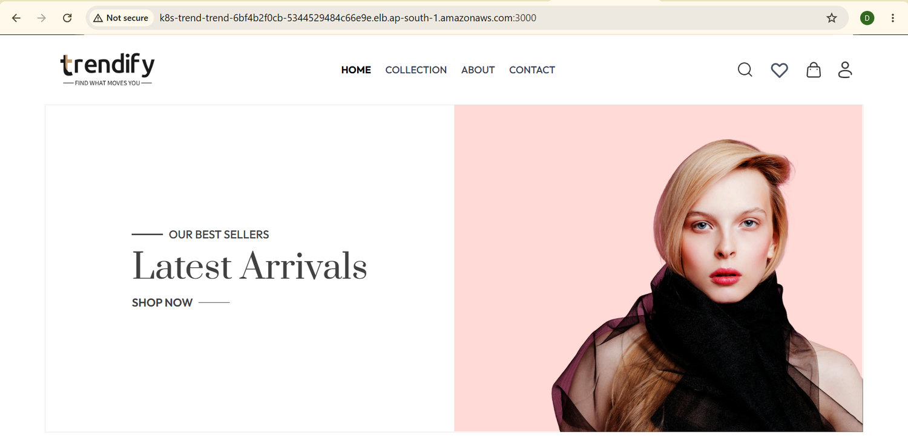
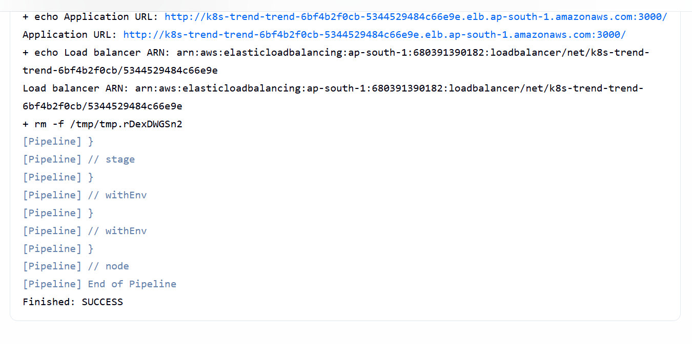
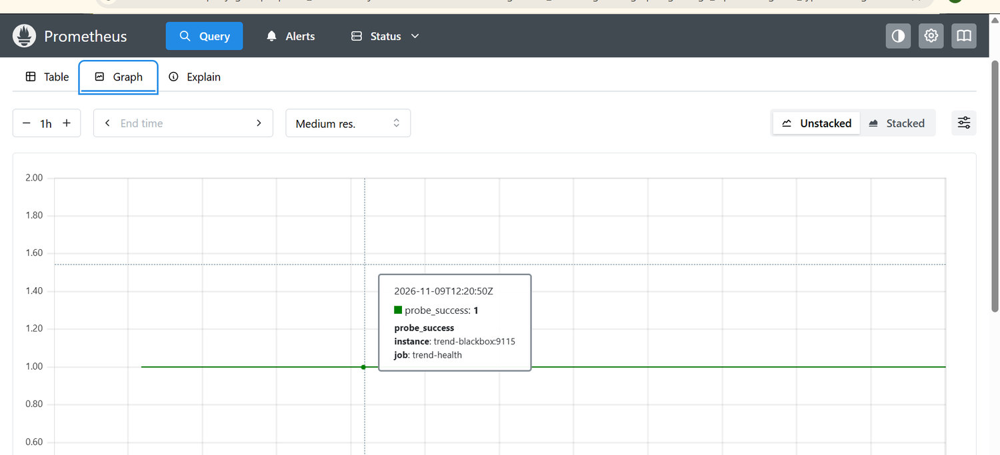

# Trend Application Deployment

GUVI DevOps Project 2 using Docker, Terraform, Jenkins, Amazon EKS, and Prometheus.

## Overview

Trend is a static storefront served by Nginx on port **3000**. The upstream repository provides the compiled site in `dist/`. The Docker build packages those files with the Nginx configuration.

Terraform provisions the AWS network, IAM roles, an EC2 instance for Jenkins, and the EKS Auto Mode cluster. When the GitHub webhook is configured, a push to `main` triggers Jenkins to build and smoke-test the image, publish it to Docker Hub with the commit SHA, and deploy it to EKS using `kubectl`. The public Network Load Balancer serves the storefront on port **3000**. Prometheus and Blackbox Exporter check its `/healthz` endpoint every 30 seconds.

## Submission details

| Item | Value |
| --- | --- |
| Author | Vijayalingam Periyasamy |
| Repository | [Trend-with-AWS-CI-CD](https://github.com/Vijayalingamgithub/Trend-with-AWS-CI-CD) |
| Upstream application | [Vennilavanguvi/Trend](https://github.com/Vennilavanguvi/Trend) |
| AWS region | `ap-south-1` (Mumbai) |
| Docker Hub image | [`dockervijay1998/trend`](https://hub.docker.com/r/dockervijay1998/trend/tags) |
| EKS cluster | `trend-eks` (Auto Mode) |
| Jenkins job | `trend-deploy` |
| Kubernetes namespace | `trend` |
| Deployment and Service | `trend` with 2 application replicas |
| Application URL | [Trend on port 3000](http://k8s-trend-trend-6bf4b2f0cb-5344529484c66e9e.elb.ap-south-1.amazonaws.com:3000/) |

**Network Load Balancer ARN**

```text
arn:aws:elasticloadbalancing:ap-south-1:680391390182:loadbalancer/net/k8s-trend-trend-6bf4b2f0cb/5344529484c66e9e
```

The URL and ARN identify the deployment captured in the screenshots. If the Service is recreated, use the new values printed by Jenkins.

## Architecture

```text
GitHub push to main
  -> Tailscale Funnel -> EC2 webhook relay -> Jenkins
  -> Build and smoke-test image -> Push commit-tagged image to Docker Hub
  -> Apply Kubernetes manifests to EKS -> Wait for rollout and check /healthz

Browser -> AWS Network Load Balancer :3000 -> Kubernetes Service -> Nginx Pods :3000
Prometheus -> Blackbox Exporter -> Public /healthz endpoint
```

## Repository structure

| Path | Purpose |
| --- | --- |
| `dist/` | Compiled Trend storefront |
| `Dockerfile`, `nginx.conf` | Container image and web server configuration |
| `terraform/` | AWS infrastructure and provider lock file |
| `Jenkinsfile` | Declarative build, test, push, and deployment stages |
| `k8s/` | Kubernetes Deployment and LoadBalancer Service |
| `webhook/` | Signature-checking relay and its systemd service |
| `monitoring/` | Prometheus and Blackbox Exporter configuration |
| `docs/`, `screenshot.md` | Deployment report and screenshot gallery |

## Deployment screenshots

See the [full screenshot gallery](screenshot.md) for Docker, Terraform, GitHub webhook, Jenkins, EKS, and monitoring evidence.







## Local Docker test

```powershell
docker build -t trend:local .
docker run --rm -d --name trend-local -p 3000:3000 trend:local
curl.exe -fsS http://localhost:3000/healthz
curl.exe -fsS -o NUL http://localhost:3000/
docker stop trend-local
```

## Provision AWS

Install Terraform, AWS CLI, and a kubectl client compatible with the cluster version. Sign in to the AWS CLI. These commands use PowerShell and should be run from the repository root.

```powershell
$PublicIp = (curl.exe -4 -fsS https://checkip.amazonaws.com).Trim()
$env:TF_VAR_admin_cidr = "$PublicIp/32"
terraform "-chdir=terraform" init
terraform "-chdir=terraform" validate
terraform "-chdir=terraform" plan "-out=trend.tfplan"
terraform "-chdir=terraform" apply trend.tfplan
aws eks update-kubeconfig --region ap-south-1 --name trend-eks
kubectl create namespace trend --dry-run=client -o yaml | kubectl apply -f -
```

Review the plan before applying. It provisions a VPC, two public and two private subnets, NAT egress, IAM roles, EKS Auto Mode, and an EC2 instance bootstrapped with Jenkins. AWS charges for these resources. Terraform state, saved plans, and credential files belong outside Git.

## Configure Jenkins

Install the AWS Session Manager plugin on Windows. Open the Jenkins dashboard through this port-forwarding session:

```powershell
$InstanceId = terraform "-chdir=terraform" output -raw jenkins_instance_id
aws ssm start-session --region ap-south-1 --target $InstanceId --document-name AWS-StartPortForwardingSession --parameters "portNumber=8080,localPortNumber=18080"
```

Open [Jenkins over SSM](http://127.0.0.1:18080/). Install the Git, GitHub, Pipeline, Credentials Binding, Docker Pipeline, and Kubernetes plugins. Install a compatible Linux amd64 `kubectl` on the EC2 host using the [official installation instructions](https://kubernetes.io/docs/tasks/tools/install-kubectl-linux/). Verify Docker and kubectl are available to the Jenkins user. The instance role supplies the AWS credentials and has EKS permissions scoped to the `trend` namespace.

Create a Jenkins **Username with password** credential with ID `dockerhub`. Use your Docker Hub username and a read/write access token. For another registry namespace, update `IMAGE_REPO` in the Jenkinsfile and create the public image repository before building.

Label the build node `docker-eks`. Create the Pipeline job `trend-deploy` using **Pipeline script from SCM**, the GitHub fork, branch `*/main`, and script path `Jenkinsfile`. Run it manually once to register the trigger and verify the build.

| Stage | What Jenkins does |
| --- | --- |
| Build and test | Packages the static site and tests the homepage and health endpoint in Docker. |
| Push image | Publishes the image to Docker Hub with the Git commit SHA as its tag. |
| Deploy to EKS | Substitutes the image tag, applies the Kubernetes manifests, waits for rollout, checks the public health endpoint, and prints the load balancer ARN. |

## GitHub push trigger

On EC2, run the [webhook relay](webhook/relay.cjs) with Node.js as a systemd service using [the service unit](webhook/trend-webhook.service). Clone this repository on EC2 and run from its root:

```bash
sudo apt-get install -y nodejs
sudo install -D -m 0644 webhook/relay.cjs /opt/trend-webhook/relay.cjs
sudo install -m 0644 webhook/trend-webhook.service /etc/systemd/system/trend-webhook.service
sudo bash -c 'umask 077; if [ ! -s /etc/trend-webhook.env ]; then printf "TREND_WEBHOOK_SECRET=%s\n" "$(openssl rand -hex 32)" > /etc/trend-webhook.env; fi'
sudo systemctl daemon-reload
sudo systemctl enable --now trend-webhook
```

Install [Tailscale on EC2](https://tailscale.com/docs/install/linux), sign in with `sudo tailscale up`, and enable Funnel for the EC2 node. Run `sudo tailscale funnel --bg http://127.0.0.1:18081` and read the public URL from `sudo tailscale funnel status`.

In GitHub, add a webhook using that HTTPS URL with `/github-webhook/` appended. Select `application/json` and push events. Keep SSL verification enabled. Paste the value printed by `sudo cut -d= -f2- /etc/trend-webhook.env` into GitHub's **Secret** field. Keep the value out of Git and screenshots. The relay validates the signature and forwards the request to Jenkins on EC2 port 8080. Push a change to `main` and verify the delivery response and Jenkins build cause.

## Monitoring

From the repository root on EC2, copy the two configuration files and start the monitoring containers. Update the health-check URL in [prometheus.yml](monitoring/prometheus.yml) if your load balancer hostname differs.

```bash
sudo install -d -m 0755 /opt/trend-monitoring
sudo install -m 0644 monitoring/blackbox.yml monitoring/prometheus.yml /opt/trend-monitoring/
sudo docker network create trend-monitoring
sudo docker volume create trend-prometheus-data
sudo docker run -d --name trend-blackbox --restart unless-stopped --network trend-monitoring -v /opt/trend-monitoring/blackbox.yml:/etc/blackbox_exporter/config.yml:ro prom/blackbox-exporter
sudo docker run -d --name trend-prometheus --restart unless-stopped --network trend-monitoring -p 127.0.0.1:9090:9090 -v /opt/trend-monitoring/prometheus.yml:/etc/prometheus/prometheus.yml:ro -v trend-prometheus-data:/prometheus prom/prometheus
```

Use an SSM port-forwarding session to map EC2 port 9090 to local port 19090. In [Prometheus](http://127.0.0.1:19090/), query `probe_success{job="trend-health"}`. A value of `1` means the last probe through the load balancer passed.

## Verification and teardown

```powershell
aws eks describe-cluster --region ap-south-1 --name trend-eks --query "cluster.status" --output text
kubectl get nodes
kubectl -n trend get deployment,pods,service
```

The [deployment report](docs/Trend%20Deployment%20Report.docx) includes evidence of the local Docker test, Terraform apply, EKS readiness, GitHub push delivery, Jenkins deployment, and Prometheus probe. When the review is finished, delete the Kubernetes Service, confirm AWS removed its load balancer, then run `terraform "-chdir=terraform" destroy` using the original state.
