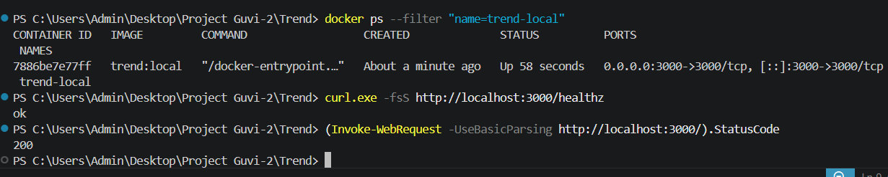
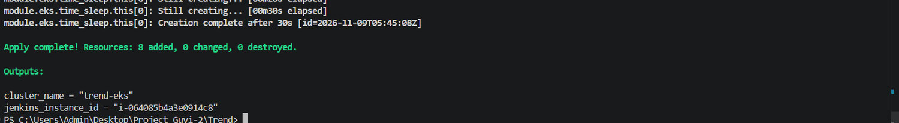
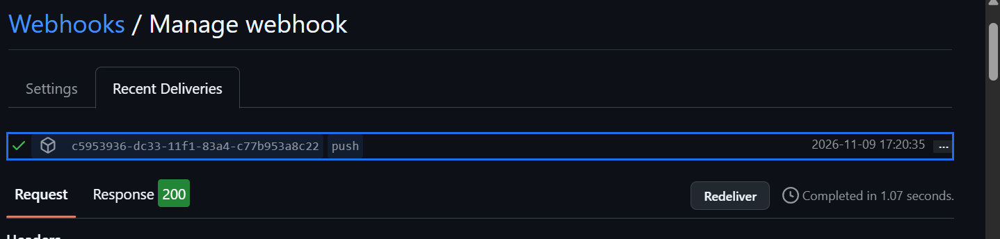
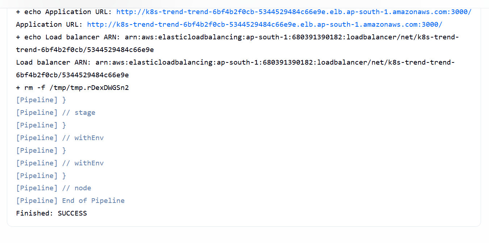
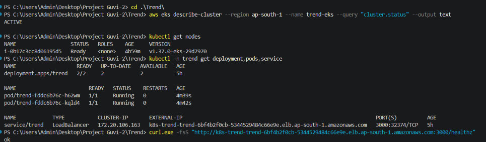
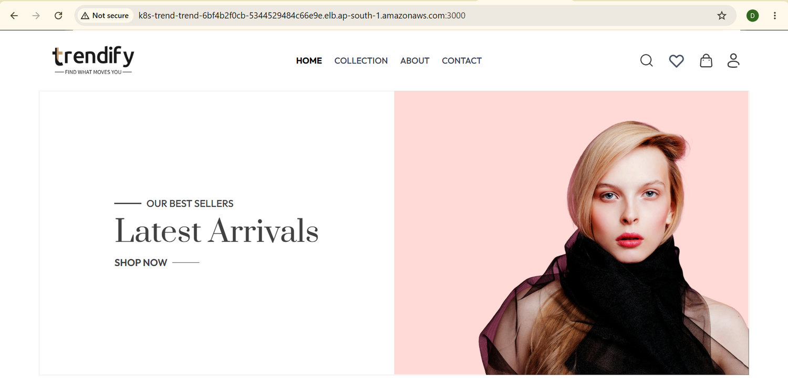
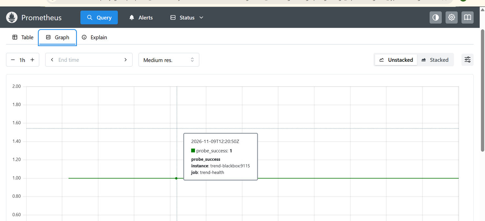

# Trend deployment screenshots

These screenshots document the recorded Trend deployment, from the local Docker test through continuous health monitoring. See the [README](README.md) for setup instructions and submission details.

## Local Docker smoke test

Docker exposes port 3000. The health endpoint returned `ok` and the homepage returned HTTP 200.

## Terraform provisioning

Terraform reported a successful apply and printed the EKS cluster and Jenkins instance outputs.

## GitHub push delivery

GitHub recorded an HTTP 200 response for a signed `push` delivery.

## Jenkins deployment

The pipeline finished successfully and printed the application URL and Network Load Balancer ARN.

## EKS workload health

The cluster was `ACTIVE`, its worker was `Ready`, and both Trend replicas were available.

## Trend on port 3000

The Trend storefront loaded through the AWS Network Load Balancer.

## Prometheus monitoring

Blackbox Exporter probed the public health endpoint. The Prometheus graph shows `probe_success = 1`.

